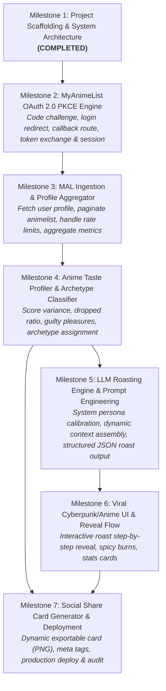

# 🍳 Manware Cooked (MyAnimeList AI Roaster)

A full-stack, viral application that fetches a user's MyAnimeList profile/watch history and delivers a hilarious, hyper-personalized roast using an LLM, paired with a shareable graphic card.

## 🏗️ Architecture & Milestone Dependency Graph



## 🚀 Getting Started

1. Copy `.env.local.example` to `.env.local` and configure your credentials:
   - `MAL_CLIENT_ID`
   - `MAL_CLIENT_SECRET` (optional if using pure PKCE)
   - `NEXT_PUBLIC_APP_URL` (`http://localhost:3000`)
   - `SESSION_SECRET`
   - `GEMINI_API_KEY`
2. Run test suites:
   ```bash
   npm test
   ```
3. Run the development server:
   ```bash
   npm run dev
   ```
