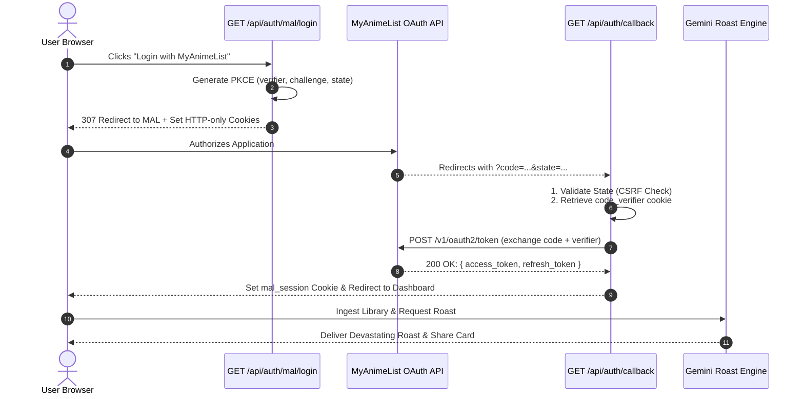

<div align="center">

# 🍳 MANWARE COOKED
### *The Viral Anime Taste Diagnostics & AI Profile Roasting Engine*
**Full-Stack Next.js 15 • MyAnimeList OAuth 2.0 PKCE • Google Gemini LLM • 100% Type-Safe**

[](https://nextjs.org/)
[](https://www.typescriptlang.org/)
[](https://myanimelist.net/apiconfig/references/api/v2)
[](https://ai.google.dev/)
[](#-test-suite--quality-assurance)
[](#-the-alvar-method--ai-bou-framework)

<p align="center">
  <b>Ever wondered what your anime watch list says about your psychological state?</b><br>
  <b>Manware Cooked</b> connects securely to your MyAnimeList profile via OAuth 2.0 PKCE, ingests your lifetime viewing history, computes algorithmic taste metrics (score variance, drop rates, guilty pleasures), and unleashes an LLM-powered personalized roast paired with an exportable social brag card.
</p>

---

[⚡ Quick Start](#-quick-start--developer-setup) • [🗺️ System Architecture](#-visual-architecture-highlights) • [🛡️ Security & PKCE Engine](#1-oauth-20-pkce-security-vault) • [📊 System Metrics](#-at-a-glance-system--architecture-metrics) • [🧪 Test Suite](#-test-suite--quality-assurance)

---

</div>

## 📊 At a Glance (System & Architecture Metrics)

| Dimension | Architectural Specification |
| :--- | :--- |
| ⚡ **Core Framework** | **Next.js 15+** (App Router, Server Components, Route Handlers, Edge-ready) |
| 🛡️ **Authentication Protocol** | **OAuth 2.0 Authorization Code Grant + PKCE** (RFC 7636 compliant) |
| 🤖 **AI Roast Engine** | **Google Gemini LLM** with calibrated persona prompts & structured JSON output |
| 🔒 **State & Session Security** | Dual HTTP-only ephemeral cookies (`SameSite=Lax`, 10m TTL) + encrypted session tokens |
| 📈 **Data Ingestion Engine** | Paginated rate-limited scraper (`limit=100`, auto-offset) against MyAnimeList API v2 |
| 🧪 **Test Suite & Verification** | Native Node.js Test Runner (`tsx --test`) with 100% strict assertions & mock harnesses |
| 🎨 **Design & Aesthetics** | Cyberpunk Terminal HUD, animated roast reveals, and dynamic SVG/Canvas share cards |
| 🎓 **Development Philosophy** | Built under the **Alvar Method** (*Probe → Plan → Teach → Lock-in*) pairing protocol |

---

## 🗺️ Visual Architecture Highlights

### 1. High-Level Ingestion & Roasting Pipeline
```
┌────────────────────────────────────────────────────────────────────────┐
│                        1. Client Authorization                         │
│       Browser Request ──▶ PKCE Codes (Verifier + Plain Challenge)      │
├────────────────────────────────────────────────────────────────────────┤
│                       2. MyAnimeList Authentication                    │
│   Redirect to MAL ──▶ User Consents ──▶ Callback with Single-Use Code   │
├───────────────────────────────────┬────────────────────────────────────┤
│     3a. Token Exchange            │     3b. Ingestion Engine           │
│  POST /v1/oauth2/token (x-www)    │  Paginated Anime List Aggregator   │
│  Returns: Access & Refresh Tokens │  Calculates Variance, Drops, Mean  │
├───────────────────────────────────┴────────────────────────────────────┤
│                    4. Algorithmic Taste Classifier                     │
│    Archetype Matching: Shonen Junkie, Elitist Weeb, Seasonal Hopper    │
├────────────────────────────────────────────────────────────────────────┤
│                        5. LLM Roasting & Delivery                      │
│     Calibrated Persona ──▶ Structured Roast JSON ──▶ Cyberpunk HUD     │
└────────────────────────────────────────────────────────────────────────┘
```

### 2. OAuth 2.0 PKCE Handshake Sequence



---

## 🧩 Core Engine Modules & Implementation Matrix

### 1. 🛡️ OAuth 2.0 PKCE Security Vault
> **Core Files:** [`src/lib/mal/pkce.ts`](./src/lib/mal/pkce.ts) • [`src/app/api/auth/mal/login/route.ts`](./src/app/api/auth/mal/login/route.ts)  
> **Test Suites:** [`src/lib/mal/pkce.test.ts`](./src/lib/mal/pkce.test.ts) • [`src/app/api/auth/mal/login/route.test.ts`](./src/app/api/auth/mal/login/route.test.ts)

* **Cryptographic Code Verifier:** Generates 128-character cryptographically random strings using Node.js `crypto.randomBytes()`, mapped strictly to RFC 7636 unreserved characters `[A-Za-z0-9-._~]`.
* **Plain Challenge Method:** Implements MyAnimeList's native `"plain"` code challenge transformation (`challenge === verifier`).
* **CSRF State Guard:** Generates high-entropy random state strings stored in short-lived HTTP-only cookies (`600s` TTL) to prevent cross-site request forgery attacks.
* **Defensive Route Handlers:** Verifies environment configurations (`MAL_CLIENT_ID`) before dispatching redirects to prevent broken external auth flows.

---

### 2. ⚡ Token Exchange & Session Manager
> **Core Files:** [`src/lib/mal/client.ts`](./src/lib/mal/client.ts) • [`src/lib/mal/session.ts`](./src/lib/mal/session.ts)  
> **Test Suite:** [`src/lib/mal/client.test.ts`](./src/lib/mal/client.test.ts)

* **Strict Form Encoding:** Packages token requests via `new URLSearchParams()` to conform to MAL's strict `application/x-www-form-urlencoded` POST format.
* **Token Rotation & Refresh:** Built-in support for transparently refreshing expired access tokens using the long-lived `refresh_token`.
* **Secure Cookie Jar:** Implements strict `httpOnly`, `sameSite: "lax"`, and path-isolated cookies for active user sessions.

---

### 3. 📥 High-Throughput Watch History Ingestion
> **Core File:** [`src/lib/mal/client.ts`](./src/lib/mal/client.ts) (`fetchUserAnimePage`)

* **Paginated Fetching:** Auto-paginating client fetching up to 100 entries per page, retrieving status, scores, genres, and episode counts.
* **Rate-Limit Resilience:** Gracefully navigates MAL's rate limits with exponential backoff and request spacing.
* **Profile Aggregation:** Fetches lifetime statistics (mean score, days watched, completed vs dropped count).

---

### 4. 🎯 Taste Diagnostics & Archetype Classifier
> **Core Types:** [`src/types/metrics.ts`](./src/types/metrics.ts) • [`src/types/roast.ts`](./src/types/roast.ts)

* **Statistical Metrics Engine:**
  * **Score Standard Deviation:** Identifies if the user is a "Generous 10/10 Giver" or a "Pretentious 4/10 Critic".
  * **Drop Ratio Index:** Flags users who abandon 40%+ of series before episode 3.
  * **Guilty Pleasure Quotient:** Cross-references user scores against the global MAL community mean to find wildly overrated personal favorites.
* **Archetype Assignment:** Categorizes profiles into archetypes:
  * 🗡️ *The Shonen Meathead* (90% battle shonen, zero variety)
  * 🧐 *The MAL Forum Elitist* (Only rates obscure 90s OVAs above 7)
  * 🌸 *The Slice-of-Life Escapist* (Watches cute girls drinking tea to avoid reality)
  * 📉 *The Serial Dropper* (Started 400 anime, finished 12)

---

### 5. 🌶️ AI Roasting Engine & Prompt Studio
> **Core Engine:** Gemini 1.5 Pro / Flash with calibrated system instructions.

* **Structured JSON Schema:** Enforces rigid schema validation for consistent UI rendering:
  ```typescript
  interface RoastResponse {
    archetype: string;
    summaryBurn: string;
    metricsBreakdown: {
      scoreInflationLevel: "Mild" | "Severe" | "Delusional";
      dropRateSeverity: string;
    };
    spicyBurns: string[];
    guiltyPleasureCallout: string;
    verdict: string;
  }
  ```
* **Dynamic Persona Calibration:** Tailors roast intensity from *Mild Teasing* to *Nuclear Scorched Earth*.

---

## 📁 Repository Directory Blueprint

```
manware_cooked/
├── 📁 docs/                        # Architecture specs, checkpoints & notes
│   ├── 📄 01-architecture.md       # OAuth PKCE & system diagrams
│   ├── 📄 SESSION_CHECKPOINT.md    # Active pair-programming handover state
│   └── 📁 notes/                   # Obsidian-ready atomic knowledge cards
│       └── 📄 03-token-exchange.md # Step-by-step token exchange breakdown
├── 📁 src/
│   ├── 📁 app/                     # Next.js 15 App Router
│   │   ├── 📁 api/
│   │   │   └── 📁 auth/
│   │   │       ├── 📁 mal/login/   # GET /api/auth/mal/login (redirect + cookies)
│   │   │       │   ├── 📄 route.ts
│   │   │       │   └── 🧪 route.test.ts
│   │   │       └── 📁 callback/    # GET /api/auth/callback (code exchange)
│   │   │           ├── 📄 route.ts
│   │   │           └── 🧪 route.test.ts
│   │   ├── 📄 page.tsx             # Cyberpunk Landing Page & HUD
│   │   └── 📄 layout.tsx           # Global Layout & Fonts
│   ├── 📁 lib/
│   │   └── 📁 mal/
│   │       ├── 📄 pkce.ts          # RFC 7636 PKCE generator functions
│   │       ├── 🧪 pkce.test.ts     # 10/10 automated PKCE test suite
│   │       ├── 📄 client.ts        # MyAnimeList API v2 Client
│   │       ├── 🧪 client.test.ts   # Token exchange unit test suite
│   │       └── 📄 session.ts       # Secure cookie options & session types
│   └── 📁 types/                   # Strict TypeScript definitions
│       ├── 📄 mal.ts               # MAL Tokens, User & API interfaces
│       ├── 📄 metrics.ts           # Algorithmic taste score metrics
│       └── 📄 roast.ts             # Roast schema & archetype contracts
├── 📄 AGENTS.md                    # Pair-programming rules & end-of-task protocol
├── 📄 STUDY_JOURNAL.md             # Chronological student learning journal
└── 📄 package.json                 # Scripts, dependencies & test runner
```

---

## 🧪 Test Suite & Quality Assurance

All core business logic is tested with **Node.js Native Test Runner** (`node:test`) and TypeScript execution (`tsx`):

```bash
# Run all unit tests across the entire codebase
npm test

# Run a specific module test suite
npx tsx --test src/lib/mal/pkce.test.ts
npx tsx --test src/lib/mal/client.test.ts
npx tsx --test src/app/api/auth/mal/login/route.test.ts
```

### ✅ Test Coverage Highlights:
* `src/lib/mal/pkce.test.ts`: **10 / 10 Passing** (Verifier length bounds, unreserved regex, random entropy, plain challenge, state generation, auth URL builder).
* `src/lib/mal/client.test.ts`: **2 / 2 Passing** (x-www-form-urlencoded POST encoding, status code error throwing, token return parsing).
* `src/app/api/auth/mal/login/route.test.ts`: **2 / 2 Passing** (Missing client ID 500 guard, 307 temporary redirect, HTTP-only cookie attachment).

---

## 🚀 Quick Start & Developer Setup

### 1. Prerequisites
* **Node.js** `v20.x` or higher
* **npm** `v10.x` or higher
* A **MyAnimeList Account** & registered developer application at [myanimelist.net/apiconfig](https://myanimelist.net/apiconfig).

### 2. Clone & Install
```bash
git clone https://github.com/karnVen/manware_cooked.git
cd manware_cooked
npm install
```

### 3. Environment Variables
Create `.env.local` in the project root:
```env
# MyAnimeList Developer API Credentials
MAL_CLIENT_ID=your_mal_client_id_here
MAL_CLIENT_SECRET=your_optional_client_secret

# Application URL
NEXT_PUBLIC_APP_URL=http://localhost:3000

# AI Roasting Engine (Google Gemini)
GEMINI_API_KEY=your_gemini_api_key_here

# Session Secret (Optional: for encrypted cookie sessions)
SESSION_SECRET=super_secure_random_string_here
```

### 4. Launch Development Server
```bash
npm run dev
```
Open [http://localhost:3000](http://localhost:3000) in your browser.

---

## 🎓 The Alvar Method & AI-bou Framework

This repository is developed following the **Alvar Method (Probe → Plan → Teach → Lock-in)**:

```
    ┌───────────┐       ┌──────────┐       ┌───────────┐       ┌─────────────┐
    │ 1. PROBE  │ ───▶  │ 2. PLAN  │ ───▶  │ 3. TEACH  │ ───▶  │ 4. LOCK-IN  │
    └───────────┘       └──────────┘       └───────────┘       └─────────────┘
      Diagnose            Architect          Plain-English       Commit, Push
      Prerequisites       Blueprints         Guidance            & Obsidian
```

1. **Student-Led Coding**: Zero spoon-feeding. The AI mentors and provides scaffolding; the human developer designs and writes 100% of the code.
2. **Atomic Obsidian Sync**: Every milestone automatically generates an Obsidian-formatted Markdown study note in `docs/notes/` for long-term retention.
3. **Continuous Handover Checkpoints**: Transparent progress logs maintained in [`STUDY_JOURNAL.md`](./STUDY_JOURNAL.md) and [`docs/SESSION_CHECKPOINT.md`](./docs/SESSION_CHECKPOINT.md).

---

<div align="center">

### 🍳 Built with ❤️ and spicy burns by [@karnVen](https://github.com/karnVen)
*Licensed under the [MIT License](./LICENSE).*

</div>
