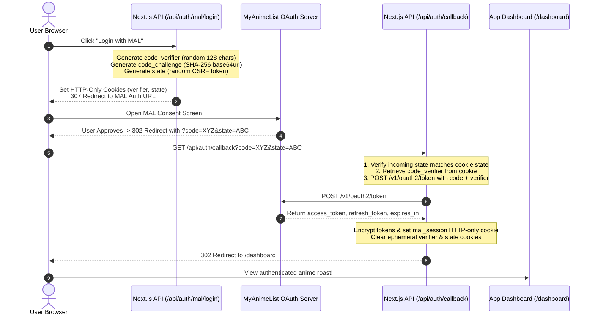

# 🛡️ Manware Cooked — OAuth 2.0 PKCE Architecture Blueprint

**Tags:** #project/main #auth #oauth #pkce #nextjs #architecture

---

## 1. System Overview

**Manware Cooked** is an AI-powered anime profile roasting and diagnostic platform. To generate accurate roasts, it accesses user watch histories, scores, and favorites from **MyAnimeList (MAL)**.

Because MAL API requires OAuth 2.0 and client secrets should never be exposed in public clients or untrusted browsers, we use **OAuth 2.0 Authorization Code Grant with PKCE (Proof Key for Code Exchange — RFC 7636)**.

---

## 2. The Complete PKCE Sequence Diagram

---

## 3. Cryptographic Invariants & Cookies

| Cookie Name | Purpose | Security Flags | Lifecycle |
| :--- | :--- | :--- | :--- |
| `mal_code_verifier` | Secret key used to verify the exchange token request | `HttpOnly; SameSite=Lax; Path=/api/auth/callback; Max-Age=600` | Ephemeral (10 mins) |
| `mal_oauth_state` | Anti-CSRF token to prevent cross-site request forgery | `HttpOnly; SameSite=Lax; Path=/api/auth/callback; Max-Age=600` | Ephemeral (10 mins) |
| `mal_session` | Encrypted session token containing access & refresh tokens | `HttpOnly; SameSite=Lax; Secure; Path=/` | Long-lived (30 days) |

---

## 4. Current Engineering State & Roadmap

- ✅ **Step 1: Scaffolding & Types:** Complete.
- ✅ **Step 2: PKCE Generator Utilities (`src/lib/auth/mal.ts`):** Complete (Unit tests 10/10 passing).
- ✅ **Step 3: Login Route (`src/app/api/auth/mal/login/route.ts`):** Complete (2/2 tests passing).
- 🎯 **Step 4: Callback Route (`src/app/api/auth/callback/route.ts`):** Ready to implement with test runner.
- ⏳ **Step 5: Anime Profile Fetcher & AI Roast Prompt Engine:** Pending Phase 2.
