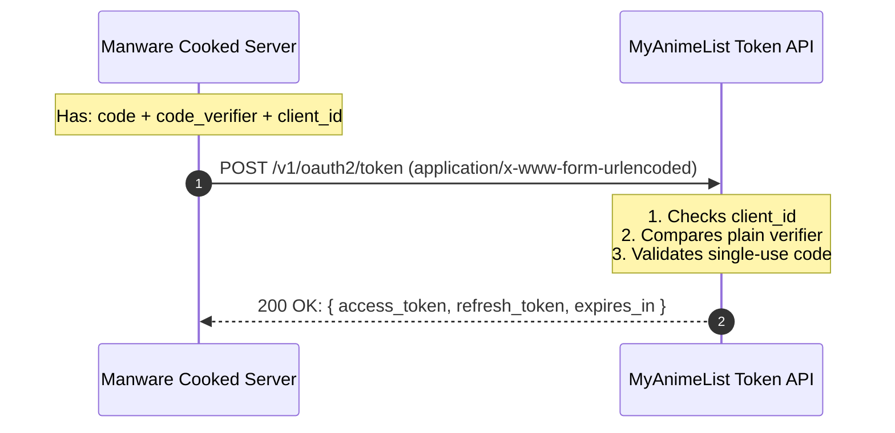

# 🔑 MyAnimeList Token Exchange: How It Works

> [!abstract] High-Level Summary
> After the user clicks "Allow" on MyAnimeList, we receive a temporary **authorization code**. 
> The `exchangeCodeForTokens` function sends that code along with our secret `code_verifier` to MAL's token endpoint to receive real **Access & Refresh Tokens**.

---

## 🗺️ Mental Model & Visual Architecture



---

## 🛠️ The 5 Mandatory Parameters

To exchange the code, MyAnimeList requires `POST https://myanimelist.net/v1/oauth2/token` formatted as `application/x-www-form-urlencoded`:

| Parameter | What It Represents | Why MAL Requires It |
|---|---|---|
| `client_id` | Your MAL App Client ID | Identifies your app. |
| `code` | The single-use authorization code | Proof the user clicked "Allow". |
| `code_verifier` | The random PKCE string generated during login | Proof our server is the one that initiated the login. |
| `grant_type` | Must be `"authorization_code"` | Tells MAL this is an initial code exchange (not a refresh). |
| `redirect_uri` | `${appUrl}/api/auth/callback` | Security check: must match the authorize URL *exactly*. |
| `client_secret` *(optional)* | Secret key if enabled in MAL dashboard | Extra layer if your MAL client is marked as confidential. |

---

## 💻 The Implementation (`src/lib/mal/client.ts`)

```typescript
export async function exchangeCodeForTokens(params: {
  clientId: string;
  clientSecret?: string;
  code: string;
  codeVerifier: string;
  redirectUri: string;
}): Promise<MALTokens> {
  // 1. Pack parameters into URLSearchParams (x-www-form-urlencoded)
  const body = new URLSearchParams({
    client_id: params.clientId,
    code: params.code,
    code_verifier: params.codeVerifier,
    grant_type: "authorization_code",
    redirect_uri: params.redirectUri,
  });

  if (params.clientSecret) {
    body.set("client_secret", params.clientSecret);
  }

  // 2. Send HTTP POST to MAL
  const response = await fetch(MAL_TOKEN_URL, {
    method: "POST",
    headers: {
      "Content-Type": "application/x-www-form-urlencoded",
    },
    body: body.toString(),
  });

  // 3. Defensive error checking
  if (!response.ok) {
    const errorBody = await response.text();
    throw new Error(`Token exchange failed (${response.status}): ${errorBody}`);
  }

  // 4. Return parsed tokens
  return (await response.json()) as MALTokens;
}
```

---

## 🧠 Key Takeaways & Common Traps

> [!warning] Gotchas & Traps
> 1. **Content-Type**: MAL OAuth endpoints do **NOT** accept `application/json`. They strictly expect `application/x-www-form-urlencoded` formatted using `new URLSearchParams()`.
> 2. **Redirect URI Mismatch**: Even a trailing slash discrepancy (e.g. `/callback/` vs `/callback`) causes an immediate `400 Bad Request`.
> 3. **Single-Use Codes**: Once an authorization code is exchanged (or rejected), it is permanently dead. A new login must be triggered to get another one.

---

## 📝 Obsidian Spaced-Repetition Cards
* **Q**: What `grant_type` is sent when exchanging an OAuth authorization code?
  * **A**: `"authorization_code"`
* **Q**: What body format does the MAL token endpoint require?
  * **A**: `application/x-www-form-urlencoded` created via `new URLSearchParams()`.
* **Q**: What does `exchangeCodeForTokens` return upon success?
  * **A**: A `MALTokens` object with `access_token`, `refresh_token`, `expires_in`, and `token_type: "Bearer"`.
