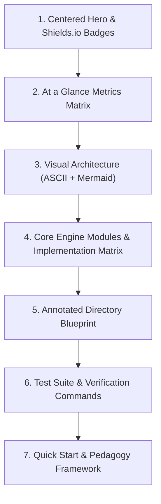

# 🎨 Engineering-Grade README Architecture (The Gakki_Vault Standard)

> [!abstract] High-Level Philosophy
> An open-source or portfolio repository is judged within the first **5 seconds** of a visitor opening the page. 
> The **Gakki_Vault Standard** elevates a GitHub repository from a plain codebase to an engineering-grade product command center using visual hierarchy, metrics tables, boxed ASCII schematics, and structured badges.

---

## 🏛️ Anatomy of the Gakki_Vault README Standard

---

## 📐 The 7 Golden Sections

### 1. Centered Hero & For-The-Badge Shields
* **Tagline & Mission Statement**: Clearly communicates *what* the project is, *why* it exists, and *what problem* it solves.
* **Shields.io Badges**: Uses `style=for-the-badge` with official brand logos (`logoColor=white`) and coordinated HEX colors:
  * Next.js: `#000000`
  * TypeScript: `#3178C6`
  * MyAnimeList: `#2E51A2`
  * Google Gemini: `#8E75C2`
  * Tests: `#10B981`
* **Quick Nav Bar**: Bullet-separated anchor links `[⚡ Quick Start] • [🗺️ Architecture] ...`

### 2. "At a Glance" System Metrics Matrix
Instead of walls of text, high-signal information is packed into a two-column markdown table:
* Dimensions: Framework, Auth Protocol, AI Engine, Session Security, Scraper Throughput, Test Runner.

### 3. Dual-Layer Visual Architecture
* **Layer A (Boxed ASCII)**: ASCII schematics (`┌───┐`, `│   │`, `└───┘`) render instantly with zero dependencies and 100% offline readability.
* **Layer B (Mermaid Diagrams)**: Dynamic sequence flows that render natively on GitHub and inside Obsidian.

### 4. Implementation Matrix
Cards detailing core sub-modules, linking directly to the source code files and their corresponding unit test files.

### 5. Repository Outer Metadata
Beyond the README file, the GitHub repository page itself requires:
* **One-line Description**: Concise, keyword-rich pitch with emoji.
* **Topic Tags**: 8–10 relevant tags (e.g. `nextjs`, `typescript`, `oauth2`, `pkce`, `myanimelist`, `ai-roast`, `anime`, `gemini-api`).

---

## 📝 Obsidian Spaced-Repetition Cards
* **Q**: What badge style gives GitHub badges the bold, solid header look?
  * **A**: `style=for-the-badge` on `img.shields.io`.
* **Q**: Why include boxed ASCII diagrams in addition to Mermaid diagrams?
  * **A**: ASCII renders universally across all terminal pagers, simple text viewers, and environments where JavaScript diagram engines are disabled.
* **Q**: What GitHub CLI command updates repository descriptions and topics from the command line?
  * **A**: `gh repo edit owner/repo --description "..." --add-topic "..."`.
