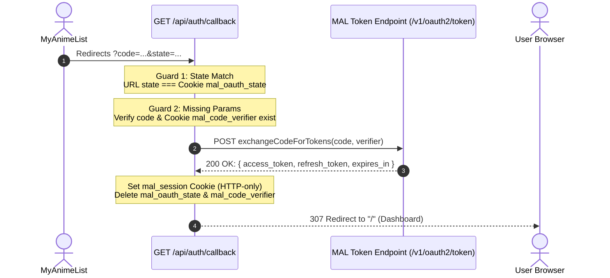

# 🛡️ OAuth 2.0 Callback: Complete Verification & Token Handshake

> [!abstract] High-Level Summary
> The callback route (`GET /api/auth/callback`) is the destination where MyAnimeList redirects users after they grant permission.
> It performs **CSRF verification**, checks credentials, contacts MAL's token endpoint to exchange the temporary code for tokens, and seals the user session into a secure, HTTP-only cookie.

---

## 🗺️ The Complete Callback Handshake Flow



---

## 🛡️ The Two Critical Security Guards

### 1. CSRF Protection Guard (State Verification)
* **What happens:** The server reads `state` from the URL and `storedState` from the user's browser cookie (`mal_oauth_state`).
* **Why it matters:** If an attacker sends a victim a malicious callback link, the victim's browser cookie will not match the attacker's `state`. The server rejects with **HTTP 403 Forbidden**.
```typescript
if (!state || !storedState || state !== storedState) {
  return NextResponse.json(
    { error: "Invalid or missing OAuth state" },
    { status: 403 }
  );
}
```

### 2. Credential Existence Guard
* **What happens:** Verifies that both the single-use authorization `code` (from MAL) and the secret `codeVerifier` (from the cookie) are present.
* **Why it matters:** Without both pieces, token exchange is impossible. The server rejects invalid or malformed requests with **HTTP 400 Bad Request**.
```typescript
if (!code || !codeVerifier) {
  return NextResponse.json(
    { error: "Missing authorization code or verifier" },
    { status: 400 }
  );
}
```

---

## 🍪 Session Lifecycle & Cookie Security

| Cookie Name | Purpose | Lifetime | Security Flags |
|---|---|---|---|
| `mal_oauth_state` | Temporary CSRF prevention | 10 minutes (600s) | `httpOnly: true`, `SameSite: "lax"` |
| `mal_code_verifier` | Temporary PKCE exchange password | 10 minutes (600s) | `httpOnly: true`, `SameSite: "lax"` |
| `mal_session` | Long-term authenticated session tokens | `tokens.expires_in` (31 days) | `httpOnly: true`, `SameSite: "lax"`, `path: "/"` |

> [!tip] Clean Cookie Hygiene
> Once the tokens are obtained, the temporary cookies (`mal_oauth_state` and `mal_code_verifier`) are immediately **deleted** via `response.cookies.delete(...)` so no orphaned authorization state remains in the browser.

---

## 📝 Obsidian Spaced-Repetition Cards
* **Q**: What HTTP status code should a callback route return if the CSRF state does not match?
  * **A**: `403 Forbidden`
* **Q**: Why do we delete `mal_code_verifier` and `mal_oauth_state` after token exchange?
  * **A**: They are single-use ephemeral secrets; keeping them after login creates unnecessary cookie clutter and security risks.
* **Q**: Where are the final MAL tokens stored in Next.js?
  * **A**: In the `mal_session` HTTP-only cookie, serialized as a JSON string with max-age matching `tokens.expires_in`.
