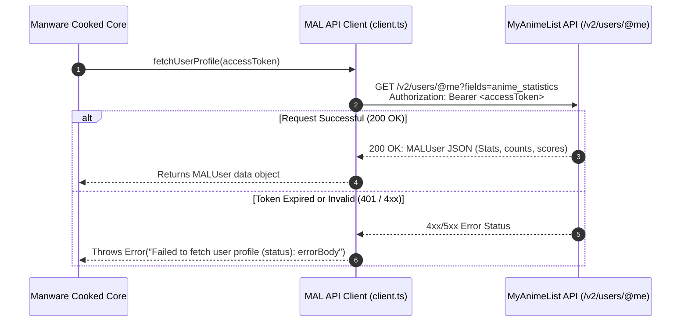

# 👤 MyAnimeList User Profile & Lifetime Statistics Ingestion

> [!abstract] High-Level Summary
> The `fetchUserProfile` client function requests the authenticated user's profile and comprehensive lifetime viewing statistics from MyAnimeList API v2 using the Bearer token acquired during OAuth 2.0 authentication.
> These statistics serve as the core diagnostic dataset powering the AI Roast Engine.

---

## 🗺️ Ingestion Flow Architecture



---

## 🧠 Key Architectural Concepts

### 1. Bearer Token Authorization
Unlike the initial OAuth code exchange which sent credentials in the body, protected REST resource endpoints in MAL API v2 require authentication via HTTP request headers:
```typescript
headers: {
  Authorization: `Bearer ${accessToken}`,
}
```

### 2. Selective Field Querying (`?fields=anime_statistics`)
By default, the `/v2/users/@me` endpoint only returns standard profile metadata (ID, username, profile picture).
By appending query parameter `?fields=anime_statistics`, MAL includes:
- `num_items_completed`, `num_items_watching`, `num_items_dropped`, `num_items_on_hold`, `num_items_plan_to_watch`
- `num_days_watched`, `num_days_completed`, `num_days_dropped`
- `mean_score` (User's average anime rating)

### 3. Defensive Response Guard Pattern
Instead of assuming `fetch` succeeds or parsing directly, always guard against non-200 responses before attempting JSON parsing:
```typescript
if (!response.ok) {
  const errorBody = await response.text();
  throw new Error(`Failed to fetch user profile (${response.status}): ${errorBody}`);
}
return (await response.json()) as MALUser;
```

---

## 💡 Flashcards & Memory Lock-in

> [!question] Q: Why must we check `!response.ok` before running `response.json()`?
> **A:** `fetch()` does not reject promises on HTTP error codes (like 401 Unauthorized or 404 Not Found). Without the `!response.ok` guard, the client would attempt to parse error pages or fail silently without contextual error diagnostics.

> [!question] Q: What HTTP header is required for authenticated MyAnimeList v2 API queries?
> **A:** `Authorization: Bearer <access_token>`
