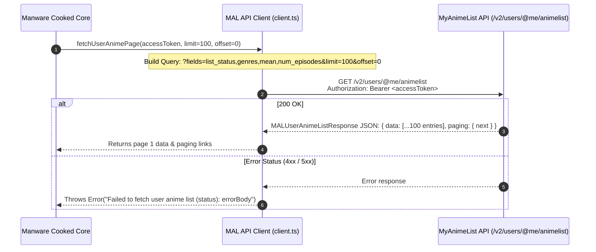

# 📑 MyAnimeList Paginated Anime List Ingestion

> [!abstract] High-Level Summary
> The `fetchUserAnimePage` function queries the authenticated user's animelist via `GET /v2/users/@me/animelist`.
> It retrieves paginated chunks of anime entries containing user scores, watch statuses, community average scores, and genre classifications—the foundational dataset for generating tailored AI roasts.

---

## 🗺️ Ingestion & Pagination Architecture

---

## 🧠 Key Architectural Concepts

### 1. Zero-Based Offset Pagination
MAL v2 animelist endpoints use standard **limit/offset pagination**:
- `limit`: The maximum number of entries to return per request (default `100`, max `1000`).
- `offset`: The zero-based index of the first record to return.

$$\text{Offset for page } n = (n - 1) \times \text{limit}$$

### 2. Multi-Field Projection (`?fields=...`)
Without projection, MAL only returns the anime ID and Title. We explicitly request:
- `list_status`: User's watch status (`completed`, `dropped`, `watching`, `plan_to_watch`) and rating (0-10).
- `genres`: Array of genre objects (`{ id, name }`).
- `mean`: Global MAL community rating (1.00 - 10.00).
- `num_episodes`: Total number of episodes in the series.

### 3. Defensive Error Formatting
Consistent with `fetchUserProfile`, all non-200 responses are intercepted via `!response.ok`, extracting raw response text to give clear debugging signals during runtime failures.

---

## 💡 Flashcards & Memory Lock-in

> [!question] Q: How does MyAnimeList API signal that more pages of anime exist?
> **A:** The response object includes a `paging` property with a `next` URL string (e.g., `{ paging: { next: "https://api.myanimelist.net/..." } }`). If no further items exist, `next` is omitted or null.

> [!question] Q: Why do we project both user `list_status.score` and community `mean`?
> **A:** This enables comparative taste heuristics (e.g. detecting "guilty pleasures" where user score $\gg$ mean score, or "hate-watches" where user score $\ll$ mean score).
